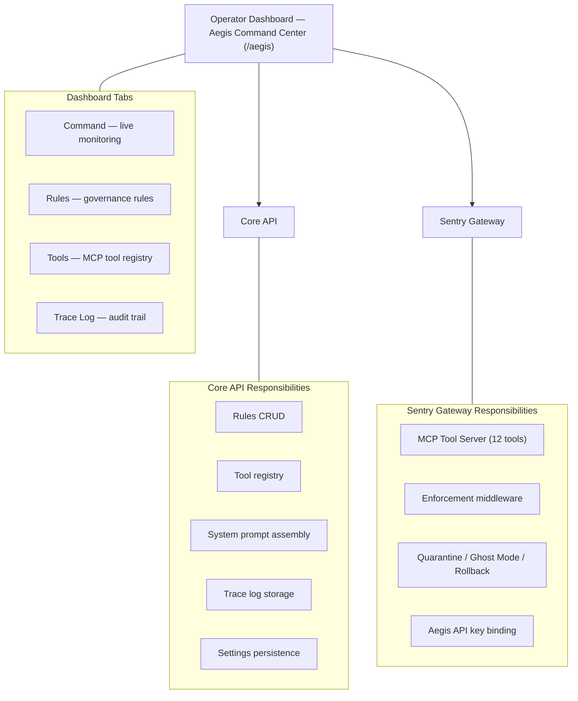

# Aegis AI Assistant — Operator User Guide

**Version:** 2.1  
**Last Updated:** 2026-06-07  
**Audience:** Platform Operators (System Administrators)


---

## What Is Aegis?

Aegis is Cicada's built-in AI platform assistant. It is **not** one of the AI agents in the swarm — those belong to your tenants and do their own business tasks. Aegis belongs to **you**, the operator. It exists to help you run the platform.

Think of it this way:

- **The swarm** = the fleet of third-party AI agents your tenants deploy (OpenAI, Anthropic models doing business tasks)
- **Aegis** = your personal AI security analyst that watches the swarm, analyses what's happening, and helps you respond

Aegis can read all the telemetry flowing through the Sentry Gateway, reason about threats, and take protective actions on your behalf — quarantining rogue agents, diverting suspicious traffic to a sandbox, or reversing harmful actions. It is the intelligence layer sitting on top of the mechanical enforcement layer.

### How Aegis Thinks

Aegis is powered by a large language model accessed via **OpenRouter**. You choose which model Aegis uses (DeepSeek R1, Claude, Llama, GPT-4, etc.) and you provide the OpenRouter API key. Cicada does not include its own LLM — it wraps the model you choose with a hardened set of tools and guardrails that give it controlled access to the platform's security control plane.

### Two-Layer Governance

Aegis operates under a **two-layer governance model**:

1. **Soft rules (System Prompt)** — Your rules and directives are prepended to every LLM call so Aegis knows what you want. Estimated token cost: ~3,000 tokens per call (~$0.002, depending on the model).
2. **Hard rules (Mechanical Enforcement)** — Before any action executes, the Gateway checks your rules mechanically. Even if the LLM ignores a rule, the enforcement layer blocks the action.

This means Aegis cannot bypass your rules — ever. The LLM tells it what *should* happen; the code ensures it *can* only happen within your boundaries.

---

## The Aegis Command Center

The Aegis Command Center is located at `/aegis` in the Operator Dashboard. It is divided into **four tabs**:

| Tab | What It Does |
|-----|-------------|
| **Command** | Live reasoning stream, action log, alerts feed, model selection, and directives |
| **Rules** | Structured rules engine — define exactly what Aegis can and cannot do |
| **Tools** | MCP tool registry — enable/disable individual tools, set HITL gates and rate limits |
| **Trace Log** | Full audit trail of every reasoning cycle Aegis has performed |

---

## Tab 1: Command

This is the main operational view, divided into three columns.

### Reasoning Panel (Left, Top)

**Amber-bordered panel — "AEGIS: REASONING"**

Shows Aegis's chain of thought when analysing a situation. When Aegis is investigating a threat, you see:

- What data it looked at
- What patterns it noticed
- What conclusions it drew
- Why it decided to take (or not take) action

When idle, the panel shows: *"Aegis is monitoring. No recent events."*

The header indicator shows **ANALYSING** (pulsing amber) when Aegis has been active in the last 5 minutes, or **IDLE** (grey) when quiet.

### Action Taken Panel (Left, Bottom)

**Cyan-bordered panel — "ACTION TAKEN"**

When Aegis decides to take a security action, this panel shows the exact JSON payload sent to the Sentry Gateway and the confirmation received back. This gives you full auditability — every action is visible with exact request and response.

When no actions have been taken, the panel shows: *"No actions taken yet."*

### Active Alerts Feed (Centre)

A live list of security actions Aegis has taken that are still in effect. Each alert card shows:

| Element | What It Shows |
|---------|---------------|
| **Status badge** | Current status (e.g., "FLAGGED", "QUARANTINED") |
| **Title** | What happened (e.g., "Agent Quarantined") |
| **Agent/Time info** | Which agent was affected and how long ago |
| **Dismiss button** | Red button to acknowledge and clear the alert |

Alerts are polled every 30 seconds. When no alerts are active, the panel shows: *"All clear. No active alerts."*

### Settings Column (Right)

#### Connections

Shows live connectivity status:

| Connection | Meaning |
|------------|---------|
| **Security Gateway — Connected** (green) | Aegis can reach the Gateway |
| **Security Gateway — Unreachable** (red) | Gateway is not responding |
| **Key Storage — Key Bound** (green) | An OpenRouter API key exists in the vault |
| **Key Storage — No Key** (amber) | No API key bound — Aegis cannot reason |

#### AI Model

Select which AI model powers Aegis. The dropdown loads available models from OpenRouter via a server-side proxy (no direct browser calls to external APIs). Default: `deepseek/deepseek-r1`.

Below the dropdown is the **Aegis API Key** input field (secured — the key is encrypted immediately on submission and never stored in plain text) to bind your OpenRouter key.

#### Trace Retention

A dropdown to control how long Aegis reasoning traces are kept:
- **30 days** (default)
- **60 days**
- **90 days**

#### Aegis Instructions

A text area where you write natural-language directives that shape Aegis's behaviour. These are the operating instructions included in every system prompt. A SAVE button appears on hover.

---

## Tab 2: Rules

The Rules tab is where you define **structured, enforceable rules** that control Aegis's behaviour. Unlike the free-text directives (which are suggestions), rules are mechanically enforced.

### How Rules Work

Each rule has:

| Field | Meaning |
|-------|---------|
| **Name** | Human-readable rule name |
| **Category** | What type of rule it is (see below) |
| **Value** | The configured threshold, permission, or scope |
| **Active** | Toggle on/off — disabled rules are not enforced |
| **Type** | System (🔒 — cannot be deleted) or Custom (can be deleted) |

### Rule Categories

| Category | Purpose | Example |
|----------|---------|---------|
| **Escalation** | Require human approval before certain actions | "Require HITL for Ghost Mode" |
| **Rate Limit** | Cap how many times Aegis can perform an action per hour | "Max 5 quarantines per hour" |
| **Threshold** | Set minimum confidence levels before Aegis can act | "Minimum 85% confidence to act" |
| **Scope** | Restrict which agent trust tiers Aegis can auto-act on | "Only auto-act on monitoring/untrusted tiers" |
| **Permission** | Simple allow/deny controls | "Allow/deny specific tool categories" |
| **Custom** | Operator-defined rules with JSON configuration | Any custom logic |

### Default Rules (System)

Six rules are pre-configured and cannot be deleted (only toggled):

1. **Require HITL for Ghost Mode** — Ghost Mode (silently diverting live traffic to a sandbox so the agent doesn't know it's being observed) is high-stakes; always require operator approval
2. **Require HITL for Rollbacks** — Saga rollbacks (reversing completed actions via compensating transactions) are irreversible in effect; always require approval
3. **Max Quarantines Per Hour** — Limit: 5/hour to prevent mass lockouts
4. **Minimum Confidence to Act** — Aegis must report 85%+ confidence before any control action
5. **Allowed Trust Tiers for Auto-Action** — Only auto-act on monitoring, untrusted, and probation tiers
6. **Protect Certified Agents** — Never quarantine or ghost-mode a certified/partner agent without approval

### Adding Custom Rules

Click **"Add Rule"** to open the creation modal:

1. Enter a **name** (e.g., "Max Ghost Mode Duration")
2. Select a **category** from the dropdown
3. Select a **type** (boolean, numeric, select, or text)
4. Write a **description** explaining what the rule does
5. Enter the **config** as JSON (e.g., `{"value": 30, "unit": "minutes"}`)
6. Click **Create Rule**

Custom rules can be deleted; system rules cannot (only disabled).

### Category Filter

Use the filter chips above the table to show rules by category: All | Escalation | Rate Limit | Threshold | Scope | Permission | Custom.

---

## Tab 3: Tools

The Tools tab shows all 12 MCP tools that Aegis has access to, with operator-configurable controls.

### Tool Groups

Tools are organised into four categories:

#### Telemetry (Read-Only)
| Tool | What It Does |
|------|-------------|
| **Get Threat Signals** | Returns anomaly counts across V01–V10 threat vectors |
| **Get Agent Velocity** | Returns current write/delete call rate for a specific agent |
| **List Quarantined** | Lists all currently quarantined agent IDs |

#### Registry (Read-Only)
| Tool | What It Does |
|------|-------------|
| **Get Agent** | Retrieves full agent record (trust tier, role, revocation state) |
| **Get Tenant** | Retrieves tenant record (plan, status, company details) |

#### Control (Privileged — amber border)
| Tool | What It Does | Default HITL |
|------|-------------|-------------|
| **Quarantine Agent** | Blocks an agent across all gateway nodes | Off (rate limited: 10/hr) |
| **Release Agent** | Unblocks a quarantined agent | Off |
| **Trigger Rollback** | Reverses a harmful action via saga compensation | **On** |
| **Engage Ghost Mode** | Silently diverts traffic to sandbox | **On** |
| **Release Ghost Mode** | Returns agent to normal routing | Off |

#### Policy (High Impact — red border)
| Tool | What It Does | Default HITL |
|------|-------------|-------------|
| **Submit Policy Revision** | Creates new inactive OPA Rego policy version | **On** |
| **Activate Policy** | Hot-reloads a policy across all nodes | **On** |

### Per-Tool Controls

Each tool card has:

- **Enabled toggle** (green = on, grey = off) — Disabling a tool means Aegis cannot call it at all
- **HITL Required toggle** (amber = on, grey = off) — When on, Aegis must get operator approval before executing this tool
- **Rate limit** (shown below toggles if configured) — Maximum calls per hour

When a tool is disabled, the card fades to 50% opacity. Disabled tools are excluded from Aegis's system prompt (it won't even know they exist).

---

## Tab 4: Trace Log

The Trace Log shows a full audit trail of every reasoning cycle Aegis has performed. Each cycle is a decision chain showing how Aegis went from a trigger signal to a final outcome.

### What You See

Each trace entry is a collapsible card showing:

| Element | Meaning |
|---------|---------|
| **Status dot** | Green (success), red (blocked), amber (pending) |
| **Trace ID** | Unique identifier for this reasoning cycle |
| **Time** | When the trace was created |
| **Decision badge** | What action Aegis decided on (e.g., "quarantine_agent") |
| **Gate badge** | PASSED (green) or BLOCKED (red) — whether the rules engine allowed the action |
| **Steps** | How many steps in the reasoning chain |
| **Tokens** | Total tokens consumed (input + output) |
| **Duration** | How long the reasoning took |
| **Model** | Which LLM was used |

### The Seven-Step Decision Chain

Each trace shows a visual pipeline of the reasoning steps:

```
trigger → context → reasoning → decision → gate → execution → result
```

| Step | What Happens |
|------|-------------|
| **Trigger** | What signal started the analysis (e.g., threat vector V03 spike) |
| **Context** | What tools Aegis called to gather data |
| **Reasoning** | Aegis's chain of thought and confidence score |
| **Decision** | What action Aegis chose to take |
| **Gate** | Rules engine check — did the rules allow this action? |
| **Execution** | The MCP tool call made to the Gateway |
| **Result** | The Gateway's response and outcome |

If a trace shows "BLOCKED" at the gate step, it means Aegis wanted to take an action but your rules prevented it. This is the two-layer governance in action — the LLM decided, but the rules engine overrode it.

### Empty State

When no traces exist yet, the tab shows: *"No reasoning traces recorded yet. Traces will appear here as Aegis processes threat signals and makes decisions."*

---

## How Aegis Connects to the Platform



---

## Where Else Does Aegis Appear?

| Location | What It Shows |
|----------|---------------|
| **Threat Correlation** (`/agent-admin/correlation`) | "Generate Aegis Briefing" button produces a threat summary |
| **Credential Vault** (`/vault`) | Aegis API key binding is the first section |
| **CIBA Approvals** (`/ciba` on Gateway Portal) | Shows paired Aegis mobile devices |
| **Alert Rules** (`/agent-admin/alert-rules`) | "aegis" is a valid notification channel |

---

## Quick Reference

| Task | How To |
|------|--------|
| **Activate Aegis** | Bind an OpenRouter API key on the Command tab or via the Credential Vault |
| **Choose Aegis's model** | Use the AI Model dropdown on the Command tab |
| **Change Aegis's behaviour** | Edit the Instructions text area on the Command tab |
| **Add a governance rule** | Go to Rules tab → click "Add Rule" |
| **Disable a tool** | Go to Tools tab → toggle "Enabled" off on the tool card |
| **Require HITL for a tool** | Go to Tools tab → toggle "HITL Required" on |
| **View Aegis's decision history** | Go to Trace Log tab |
| **Set trace retention** | Use the Trace Retention dropdown on the Command tab |
| **Dismiss an alert** | Click "Dismiss" on the alert card in the Command tab |

---

## Security Model

| Aspect | How It's Enforced |
|--------|-------------------|
| **Aegis authentication** | `CICADA_AEGIS_TOKEN` environment variable — bearer token on all MCP calls |
| **IP boundary** | MCP endpoint restricted to loopback + `CICADA_AEGIS_ALLOWED_IPS` |
| **Tool guardrails** | Tools can be individually disabled or HITL-gated via the Tools tab |
| **Rules enforcement** | Two layers: system prompt (soft) + mechanical gateway enforcement (hard) |
| **Audit trail** | Full trace log of every reasoning cycle with token costs and timing |
| **Key isolation** | Aegis's OpenRouter key uses `sys_admin_core` tenant — separate from client keys |
| **Directive persistence** | Instructions stored in `platform_policies`, versioned via audit log |

---

*This guide is part of the Cicada Operator Manual. For technical details, see the companion Credential Vault Forensic Audit.*
