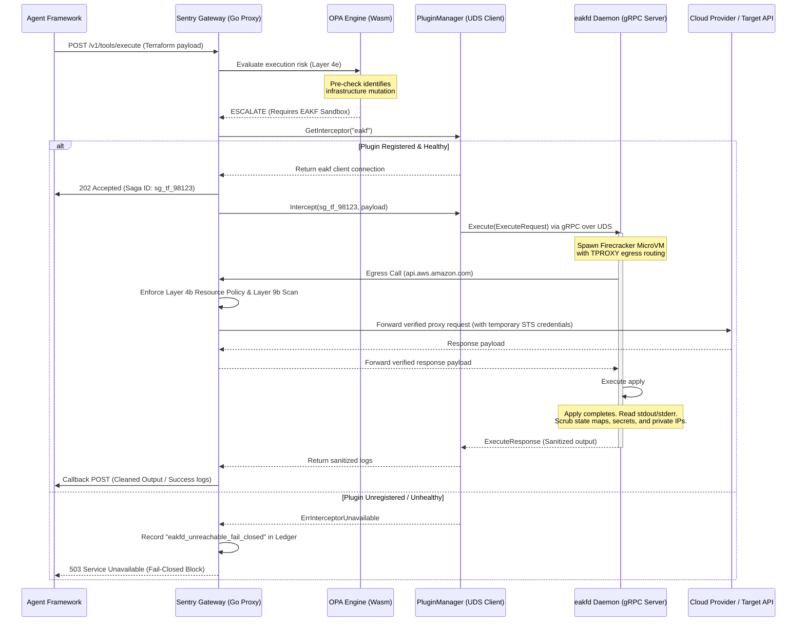

# Zero-Trust Compute: The Ephemeral Agent Kernel Firewall (EAKF)

## Mitigating "The DevOps Wall" and Host-Level Lateral Movement

**Classification:** Technical Blueprint & Architecture Design  
**Author:** Affinity Ops Engineering  
**Status:** Draft / Next-Generation Proposal  

---

## 1. Executive Summary & The Inward Threat Vector

The **Sentry Gateway** is an edge-interposing proxy. By acting at the API ingress/egress boundaries, it prevents unauthorized external calls, leaks of credentials, and malicious out-of-domain actions before they dial public or third-party endpoints.

However, a structural security boundary exists: **the Gateway cannot govern host-internal execution.**

When an autonomous AI agent is configured with a code-execution engine (such as LangChain's `PythonREPL`, OpenInterpreter, or custom script execution tools) to perform tasks like infrastructure provisioning, database migrations, or server config changes, the threat model changes. If an attacker successfully prompt-injects the agent, the malicious payload does not need to dial external endpoints to cause damage. It can:
1.  Execute local shell scripts that wipe the host system files.
2.  Scan local network interfaces, metadata services (e.g., AWS IMDSv2 at `169.254.169.254`), and internal subnets.
3.  Inject backdoors into local files, databases, or daemon services sharing the same host space.

Because these actions occur entirely within the agent's host context or local private subnet, **they bypass the Sentry Gateway proxy entirely.**

The **Ephemeral Agent Kernel Firewall (EAKF)** is a zero-trust compute architecture designed to solve this problem. It extends the Matthews Enforcement Framework from *network-edge interception* to *compute-instruction sandboxing*, treating every code-execution tool invocation as a potential host-takeover attempt.

---

## 2. The "Inside-Out" Vulnerability Model

Traditional virtualization platforms (like Docker or shared Kubernetes nodes) are vulnerable to container escape, credential inheritance, and host-network access. 

```
[ Host / Virtual Network (Private Subnet) ]
  ├── Shared Host Kernel (Vulnerable to Escape)
  ├── Local Filesystem (AWS Keys, Config Files)
  └── Private Microservices (DBs, Internal APIs)
       ▲
       │ (Unrestricted local code execution runs here)
[ Compromised Agent Node ]
```

### The DevOps Wall
To provision infrastructure, agents are often granted raw credentials or shell execution access to tools like Terraform. Giving an LLM-driven agent direct access to run these commands on the core network is a catastrophic vulnerability. If prompt-injected, the agent can:
*   Modify Terraform state maps to leak internal DB credentials.
*   Accidentally or maliciously delete VPCs, gateways, or storage volumes.
*   Spin up unauthorized GPU instances for cryptomining.

---

## 3. The EAKF Solution: Ephemeral Virtualization

The EAKF acts as a **dynamic virtualization middleman** that sits between the agent's reasoning loop and the host OS. When the agent attempts to write, compile, or execute code, the EAKF intercepts the execution request, spawns an isolated, single-use sandbox, runs the code, and strips out dangerous assets before returning the output.

```
                                  ┌───────────────────────────┐
                                  │      Sentry Gateway       │
                                  └─────────────┬─────────────┘
                                                │ (Intercepts Code Exec Tool)
                                                ▼
┌────────────────────────────────────────────────────────────────────────────────────────┐
│                        Ephemeral Agent Kernel Firewall (EAKF)                          │
├────────────────────────────────────────────────────────────────────────────────────────┤
│                                                                                        │
│  1. Spawns MicroVM               2. Executes Code              3. Scrubs Output        │
│  ┌─────────────────────────┐     ┌──────────────────────┐      ┌────────────────────┐  │
│  │ Firecracker / gVisor    │ ──► │ • Block Host Net     │ ──►  │ • Strip Secrets    │  │
│  │ < 150ms startup time    │     │ • Limit CPU / RAM    │      │ • Strip DB Maps    │  │
│  │ Read-only root FS       │     │ • Max 5s execution   │      │ • Strip Private IPs│  │
│  └─────────────────────────┘     └──────────────────────┘      └────────────────────┘  │
└───────────────────────────────────────────────┬────────────────────────────────────────┘
                                                │
                                                ▼ (Verified Result Only)
                                  ┌───────────────────────────┐
                                  │   Agent Reason loop Context│
                                  └───────────────────────────┘
```

### Key Pillars of EAKF Execution

1.  **Instruction-Level Interception:** The Sentry Gateway intercepts execution payloads targeted at standard tool interfaces (e.g. `POST /v1/tools/execute_code`).
2.  **Sub-150ms MicroVM Provisioning:** Using microVM architectures (like **AWS Firecracker** or **gVisor**), the EAKF spawns a strictly isolated virtual environment with a shared read-only template OS. It does not use standard Docker containers, which share the host kernel.
3.  **Inside-Sandbox Network Policy & DNS Allowlisting (Egress Routing):** Rather than giving the microVM raw, unmonitored egress, all network routing is locked down inside the sandbox:
    *   **Tap Device Mapping:** The microVM has a virtual network tap device (`tap0`) bridged to the host.
    *   **TPROXY Interception:** Local `iptables` rules inside the microVM kernel capture all outbound TCP connections on ports 80 and 443 and redirect them to a local transparent proxy (TPROXY) socket.
    *   **Proxy-to-Gateway Channel:** The TPROXY socket forwards all requests directly back to the **Sentry Gateway** on the host. The gateway evaluates these requests against the agent's specific **Layer 4b Resource Policies** (glob pattern URL allowlists) and **Layer 9b Output Inspection**.
    *   **Private VPC Endpoint Mapping:** To allow tools like Terraform to reach private state backends or database subnets, the Sentry Gateway exposes these internal resources as secure, mTLS-proxied loopback aliases inside the VM. The microVM never sees the real subnet IPs or routing maps.
4.  **Temporary Credentials Lifecycle & Disaster Recovery:**
    *   **Dynamic STS Minting:** The Sentry Gateway dynamically requests short-lived, low-privilege temporary session credentials (e.g., AWS STS `AssumeRole` or GCP STS tokens) on behalf of the agent.
    *   **Scope and TTL Limits:** These credentials are scoped strictly to the resources declared in the agent's policy manifest (`allowed_infra_scopes`) and carry a Time-to-Live (TTL) matched to the execution window.
    *   **Partial Apply Resilience:** If the microVM crashes or is terminated mid-apply, EAKF relies on remote state locking (e.g., DynamoDB/S3 or Consul locks) managed directly by the Sentry Gateway host. If a lock is abandoned, the gateway transitions the execution saga to a `FAIL_PARTIAL` state, holding the lock and triggering an emergency **Aegis CIBA notification** to the operator dashboard. The operator is prompted to either run an automated `destroy` rollback in a new sandbox or release the lock for manual DevOps intervention.
5.  **Configuration-Driven Execution Models (Sync vs Async):**
    *   **Synchronous Fast-Path (Default: 5s timeout):** Used for lightweight calculations, text processing, or utility scripts. The agent's thread blocks and awaits the response synchronously.
    *   **Asynchronous Saga-Path (Configurable up to 30m):** Used for long-running infrastructure deployments (e.g., `terraform apply`). When triggered:
        1.  The Sentry Gateway returns an immediate `202 Accepted` response containing a unique Saga ID and a callback hook.
        2.  The EAKF executes the task in a background microVM thread, periodically updating a secure Redis status log.
        3.  The agent framework polls the status endpoint or registers a webhook to receive the finalized, scrubbed execution logs.
    *   **Non-Blocking Agent Context Re-injection:** To prevent the LLM reasoning loop from blocking during a 30-minute infrastructure apply, the Cicada SDK coordinates with agentic orchestrators (such as LangGraph or AutoGen). The SDK maps the tool node execution to a `PENDING` state and instructs the planner to yield execution threads. Once Sentry Gateway emits the asynchronous callback payload (containing the sanitized, scrubbed stdout logs), the SDK catches the webhook, maps the Saga ID back to the waiting node, injects the cleaned execution logs directly into the agent's chat context, and re-triggers the agent's planning agent via a framework event (`on_tool_complete`). This prevents LLM hallucination and spinning during long operations.
6.  **Decoupled Output Scrubbing Engine:** Post-execution, the EAKF interceptor reads the VM's standard output, standard error, and modified files. Before passing this data back to the gateway:
    *   It scrubs all environment variables, access tokens, and passwords.
    *   It strips infrastructure diagrams and state records (such as `.tfstate` maps) to ensure the agent only receives the *result of the deployment* (e.g., `Cluster Created Successfully`), not the underlying cryptographic keys or network maps.
7.  **Instantaneous Destruction:** Once execution terminates (or hits a hard timeout), the microVM's memory map is cleared, the virtual block device is deleted, and the context is permanently erased.

---

## 4. Matthews Enforcement Framework (MEF) Integration & Plug-in Architecture

To preserve architectural cleanliness, the Sentry Gateway core contains **zero hardcoded compile-time dependencies or imports** of the EAKF execution codebase. The gateway treats EAKF strictly as a dynamically registered **interceptor plug-in** that hooks into the request pipeline.

### The Interceptor Plug-in Interface

The Sentry Gateway defines a generic, abstract extension boundary in its pipeline runner (`internal/plugin/manager.go`):

```go
// Interceptor defines the contract for optional execution-plane plugins.
type Interceptor interface {
    // Name returns the unique identifier of the plugin (e.g. "eakf").
    Name() string
    
    // EventFilter evaluates whether the request matches the plugin's trigger criteria
    // (e.g., matching a target URL like "/v1/tools/execute" or checking if the agent's
    // policy has requested sandboxed compute).
    EventFilter(req Request) bool
    
    // Intercept handles the execution flow. For EAKF, this delegates execution to the
    // gRPC daemon socket and returns a structured result.
    Intercept(ctx context.Context, req Request) (Result, error)
}
type Result struct {
    Handled bool
    Blocked bool
    Reason  string
    Stdout  string
    Stderr  string
}
```

At boot, Sentry Gateway initializes the `PluginManager`. If the environment variable `CICADA_PLUGINS=eakf` is set, the gateway registers a UDS-based client implementing the `Interceptor` interface, binding to `/var/run/cicada/eakf.sock`.

### Execution Flow & Sequence

During pipeline evaluation, if the OPA policy engine determines that a request is a code execution call requiring sandboxing:
1.  The gateway loops through the `PluginManager`'s active interceptors.
2.  If an interceptor matching `"eakf"` is registered, execution is delegated to it over the UNIX Domain Socket.
3.  **Fail-Closed on Plugin Absence:** If the agent policy manifest requests sandboxing, but the plugin registry does not contain an active `"eakf"` registration (or the gRPC UDS connection is broken), the request fails closed immediately.



---

## 5. State & Credential Scrubbing (Data Loss Prevention)

The core challenge of the DevOps wall is that the agent needs to know if the deployment succeeded, but it *must not* learn the secrets or maps generated during the deployment. The EAKF incorporates a **Deterministic State Sieve**:

| Intercepted File / Output Type | Danger Vector | Scrubbing Rule |
|---|---|---|
| **Terraform `.tfstate`** | Contains database master passwords, private subnet IPs, and route keys. | Redact entire JSON object structure. Extract only resource creation count metrics (e.g. `12 resources created`). |
| **AWS API Credentials** | Raw keys exposed during dynamic environment exports. | Regex sweep of `AKIA` / `ASCA` prefixes. Replace with `[REDACTED_BY_EAKF]`. |
| **Private IP Addresses** | Allows agent to target local internal systems. | Strip all private IP ranges (`10.x.x.x`, `172.16.x.x`, `192.168.x.x`). |
| **Database Connection Strings** | Exposes host port, database name, and user parameters. | Strip credentials. Replace with synthetic loopback parameters or mock values. |

---

### 5.1 Scrubbing Engine Limitations & Secrets Management Complement

> [!WARNING]
> **Scrubbing Engine Limitations:** 
> Deterministic regex and pattern sieves are strong default filters, but they cannot guarantee detection of arbitrarily structured data or custom, developer-defined output variables (for example, a custom Terraform output block explicitly named `database_password`). 

To address this limitation, the EAKF scrubbing engine is positioned as a **complementary safety layer, not a replacement for enterprise secrets management**. 
*   **The Zero-Trust Architecture Pattern:** Enterprise customers must use their existing secrets managers (such as HashiCorp Vault or AWS Secrets Manager) to inject dynamic secrets directly into the target microVM environment at runtime. 
*   **Preventing Secret Leakage:** Secrets must never be declared as outputs inside Terraform files or code scripts. The Sentry Gateway's Policy Sanitizer scans configurations at registration and automatically flags any policy definition that exposes unredacted output keys.

---

## 6. Evaluation: Is this a great way to protect the network?

### Why it is highly effective:
*   **Shrinks the Blast Radius to Zero:** Because the code runs inside a microVM with a read-only root system and restricted CPU time, any malicious activity (e.g., shell injection, cryptomining, system deletions) executes within a throwaway container and vanishes upon termination.
*   **Enforces Zero-Trust Internally:** Sentry Gateway already protects the boundary. EAKF extends that protection *inside* the execution runtime. Even if the agent is fully compromised, it cannot compromise the network it resides on because it has no pathway to communicate with the host.
*   **Eliminates Credential Hoarding:** Since the firewall intercepts output and redacts all secrets before sending them to the agent, the agent's long-term memory or vector database cannot be poisoned with production database passwords or access keys.

### Engineering & Performance Challenges:
1.  **Startup Latency:** Standard Docker containers take 500ms to 2s to provision. Using Firecracker microVMs with snapshot-resumption reduces boot times to **< 5ms**, making the virtualization loop imperceptible to the agent's execution latency.
2.  **Resource Overheads:** Spawns require host hypervisor access. In containerized edge environments (like Kubernetes nodes), running microVMs requires nested virtualization support, which must be configured in the underlying cloud host instances (e.g., AWS metal or GCP `.metal` machines).
3.  **State Synchronization:** If the agent runs Terraform, the actual state must be stored securely *outside* the agent's view. The EAKF must write the `.tfstate` file directly to an air-gapped, encrypted S3 bucket, ensuring the agent only gets the execution logs.

---

## 7. Deployment Architecture & Kubernetes Integration

A major concern for enterprise buyers is the operational overhead of running hardware-level hypervisors (KVM) within their existing cloud infrastructures. To make EAKF deployment highly adaptable, we define three integration blueprints:

```
                            ┌────────────────────────┐
                            │    DEPLOYMENT TIER     │
                            └───────────┬────────────┘
                                        │
         ┌──────────────────────────────┼──────────────────────────────┐
         ▼                              ▼                              ▼
┌──────────────────┐           ┌──────────────────┐           ┌──────────────────┐
│   Bare-Metal     │           │   Kubernetes     │           │    Serverless    │
│  (Firecracker)   │           │     (gVisor)     │           │    (Fargate)     │
└────────┬─────────┘           └────────┬─────────┘           └────────┬─────────┘
         │                              │                              │
         ▼                              ▼                              ▼
┌──────────────────┐           ┌──────────────────┐           ┌──────────────────┐
│ KVM enabled node │           │ Native Pod       │           │ Delegated API    │
│ < 5ms startup    │           │ RuntimeClass     │           │ sandbox calls    │
└──────────────────┘           └──────────────────┘           └──────────────────┘
```

### Option A: Bare-Metal Firecracker Nodes (Optimal Performance)
*   **Best for:** High-frequency, time-sensitive code execution where sub-10ms container cold starts are required.
*   **Implementation:** Sentry Gateway runs alongside a local daemon (`eakfd`) that has direct access to `/dev/kvm`. It spins up Firecracker microVMs locally using pre-warmed memory snapshots.
*   **Requirement:** Cloud instances must support hardware virtualization (e.g., AWS `metal` or `.metal` instances, GCP nested virtualization-enabled custom images).

### Option B: Kubernetes Native Isolation via gVisor (Low Friction)
*   **Best for:** Standard Kubernetes deployments (EKS, GKE, AKS) where bare-metal worker nodes or nested virtualization are cost-prohibitive.
*   **Implementation:** EAKF uses **gVisor (`runsc`)** configured as a native Kubernetes `RuntimeClass`. When the agent requests code execution, EAKF submits a lightweight Pod manifest targeting this runtime class. gVisor runs a user-space kernel that intercepts and filters all host-level syscalls.
*   **Requirement:** No hardware KVM or nested virtualization required. Installs as a daemonset or node configuration inside the existing Kubernetes cluster.

### Option C: Delegated Serverless Sandboxing
*   **Best for:** Decentralized architectures or environments where cluster node mutation is blocked by corporate policy.
*   **Implementation:** Sentry Gateway delegates code execution requests to a managed, serverless container execution pool (e.g., AWS Fargate, GCP Cloud Run, or Knative) with default-deny network and IAM policies.
*   **Requirement:** Out-of-cluster API endpoints; cold start times range from 500ms to 2s.

### 7.4 Packaging as an Opt-In Plugin (Modular Architecture)

Because not every Cicada user deploys DevOps agents or has nested virtualization infrastructure, the EAKF is designed as a **pluggable extension** rather than a core binary requirement. This modularity prevents dependency bloat and keeps the gateway footprint minimal for standard API-proxy workloads.

#### The Plugin Interface Options:

```
[ Sentry Gateway Core ] 
         │ (Tool Execution Request)
         ▼
 ┌───────────────┐
 │ Plugin Manager│ ── Gated by: `CICADA_PLUGINS=eakf`
 └───────┬───────┘
         │
         ├── Option A: gRPC Service Daemon (Decoupled Process over TCP/UDS)
         │   [ eakfd Daemon ] ──► (Controls local /dev/kvm)
         │
         └── Option B: Go Build-Tag Module (In-process compile gate)
             [ internal/plugins/eakf ]
```

1.  **Option A: Decoupled gRPC Service Daemon (`eakfd`) — (Recommended):**
    *   **Architecture:** The EAKF runs as an independent daemon (`eakfd`) on the host node, exposing a high-performance gRPC server. The default IPC mechanism is a **UNIX Domain Socket (UDS)** (e.g. `/var/run/cicada/eakf.sock`), which avoids TCP port conflicts, restricts access via OS file permissions, and minimizes IPC latency.
    *   **Interception:** Sentry Gateway registers a tool execution handler. When `CICADA_PLUGINS=eakf` is enabled, the gateway dials the UDS socket and proxies code payloads to `eakfd`.
    *   **Uptime & Lifecycle Separation:** Operating EAKF as a separate daemon isolates host-level KVM, Firecracker, or nested virtualization dependencies. This allows operators to patch the underlying hypervisor, configure nested VM block structures, or restart the sandbox daemon for security updates without triggering gateway downtime.
    *   **Fail-Closed Unreachability Policy:** If `eakfd` is configured but unreachable (due to OOM, crash, or slow restart), the gateway enforces a strict **fail-closed** policy. Tool execution requests are blocked instantly, an error code is returned, and a high-severity action ledger event (`eakfd_unreachable_fail_closed`) is recorded.
2.  **Option B: Compile-Time Build Tags:**
    *   **Architecture:** The EAKF code resides in `internal/plugins/eakf`. It is only compiled into Sentry Gateway if the build flag `make build-devops` (adding Go build tag `-tags devops`) is explicitly run.
    *   **CI/CD & Testing Matrix Cost:** Introducing build tags splits compilation pathways. To prevent regression errors, the CI/CD pipeline must execute the entire 1,143-test suite against both build configurations (`go test ./...` and `go test -tags devops ./...`) on every commit.
    *   **Commercial SKU Tiering:** Build-time tagging provides a clean path for packaging the DevOps engine as a separate Enterprise SKU, allowing Affinity Ops to distribute specialized binaries to high-compliance buyers without shipping dormant hypervisor dependencies to standard customers.

By packaging EAKF as an opt-in plugin, we protect standard gateway users from virtual-appliance overheads while providing enterprise customers with a drop-in sandbox engine.

---

## 7.5 gRPC Service Interface Definition (`eakf.proto`)

To prevent cross-system contract drift and pin down execution boundaries early, both the Sentry Gateway core and the `eakfd` daemon adhere to a strict protobuf contract. 

```protobuf
syntax = "proto3";

package cicada.eakf.v1;

option go_package = "github.com/asai/cicada/sentry/pkg/eakf/v1;eakfv1";

// EphemeralAgentKernelFirewall coordinates secure tool execution sandboxes.
service EphemeralAgentKernelFirewall {
    // Execute runs the provided script payload within an isolated guest container/microVM.
    rpc Execute(ExecuteRequest) returns (ExecuteResponse);
}

// ExecuteRequest defines the input code payload and virtual resource boundaries.
message ExecuteRequest {
    string saga_id = 1;
    string agent_id = 2;
    string tenant_id = 3;
    
    // Script or configuration content (e.g. Terraform payload, Python REPL script).
    string payload = 4;
    // Execution runtime hint (e.g. "python3", "bash", "terraform").
    string runtime_hint = 5;
    
    // Sandbox resource limits.
    int32 timeout_seconds = 6;
    int32 max_memory_mb = 7;
    int32 max_cpus = 8;
    
    // Allowlisted egress destinations bridged to the host proxy routing table.
    repeated string allowed_egress_domains = 9;
    repeated string allowed_infra_scopes = 10;
    
    // Serialized JSON of the agent's policy manifest (e.g. tools, scopes, limits)
    // to allow eakfd to make autonomous scrubbing decisions without back-channel calls.
    bytes policy_manifest_json = 11;
}

// ExecuteResponse defines the execution results, exit codes, and telemetry logs.
message ExecuteResponse {
    string saga_id = 1;
    
    // Process outcome signals.
    int32 exit_code = 2;
    bool execution_success = 3;
    
    // Sanitized console outputs (credentials, state maps, private IPs stripped).
    string sanitized_stdout = 4;
    string sanitized_stderr = 5;
    
    // Scrub telemetry mapping what was filtered.
    repeated string redacted_keys = 6;
    repeated string redacted_ips = 7;
    
    // Saga state indicators.
    enum Status {
        STATUS_UNSPECIFIED = 0;
        STATUS_SUCCESS = 1;
        STATUS_FAILED = 2;
        STATUS_PARTIAL_APPLY = 3;
        STATUS_TIMEOUT = 4;
    }
    Status status = 8;
}
```

---

## 7.6 Separation of Concerns (Configuration vs. Enforcement Planes)

To keep Sentry Gateway operations and portal configurations decoupled, the EAKF plugin splits responsibilities between the **Developer Portal (Configuration)** and the **Sentry Gateway (Enforcement)**.

### A. What Lives in the Developer Portal (Configuration Plane)
The Developer Portal does not contain execution logic, hypervisor controls, or container interfaces. Instead, it serves as the user-facing administration surface:
1.  **Agent Scaffolder Wizard & Settings:** A registration step (or post-registration settings panel) where a developer declares that their agent requires code-execution capabilities. Here, they:
    *   Select the runtime target (e.g., `python3`, `bash`, `terraform`).
    *   Choose the execution mode (`sync` or `async`).
    *   Define the `allowed_infra_scopes` and memory/CPU resource bounds.
    *   Configure execution timeout parameters.
2.  **Policy Manifest Generation:** An opt-in checkmark that writes the EAKF sandbox policies directly to the agent's `cicada.yaml` policy-as-code file and persists the settings in the database against the agent's Biography.
3.  **Real-Time Status Indicator:** A visual status badge on the Agent Biography view (visible in both the Developer Portal and Operator Dashboard) showing EAKF status:
    *   `Enabled` (EAKF is configured, and the local gateway has the plugin active).
    *   `Disabled` (The agent has not requested code execution capabilities).
    *   `Misconfigured` (The agent's policy requests EAKF, but the active Sentry Gateway deployment has `CICADA_PLUGINS=eakf` inactive).

### B. What Lives in Sentry Gateway & eakfd (Enforcement Plane)
All compute and isolation logic runs on the infrastructure side:
*   The `eakfd` daemon, KVM interfaces, microVM templates, transparent proxies, and output scrubbing scripts.
*   The Developer Portal never communicates with execution runtimes directly.

### C. The Fail-Closed Intent Enforcement
By registering an agent with EAKF enabled, the developer declares a clear intent: *"This agent will submit code execution requests."*
*   **Active Plugin State:** If the agent submits a code execution request and the gateway's environment has `CICADA_PLUGINS=eakf` active, the call is routed to the sandbox.
*   **Inactive/Misconfigured State:** If the agent's policy requests EAKF but the gateway does not have `CICADA_PLUGINS=eakf` active (unregistered/disabled plugin), Sentry Gateway **blocks all code execution requests** from that agent entirely.

---

## 7.7 Alerting, Telemetry, and CIBA Integration

Because EAKF is a decoupled plugin, its telemetry, error output, and alert profiles must be explicitly funneled back through Sentry Gateway's core auditing pipeline to trigger operator notifications.

### A. Telemetry & Alert Propagation
When the EAKF plugin detects a violation during execution (such as a pattern scrub, unauthorized IP connection attempt, or resource limit breach):
1.  The plugin flags the event inside the `ExecuteResponse` payload (populating `redacted_keys`, `redacted_ips`, or returning `execution_success = false`).
2.  The Sentry Gateway catches this response and automatically dispatches a structured JSON alert event (`eakf_policy_violation` or `eakf_redaction_alert`) to the Core API via `internal/output/threat_alert.go`.
3.  The Core API broadcasts this telemetry over WebSockets, instantly updating the **Operator Dashboard** and registering the event in the agent's Biography timeline.

### B. CIBA & Saga Recovery (Fail-Closed Rollbacks)
For high-risk infrastructure actions (like a long-running Terraform apply) that encounter a partial failure (`STATUS_PARTIAL_APPLY`), automatic recovery requires human oversight:
1.  Upon receiving a partial-apply state signal from `eakfd`, Sentry Gateway locks the remote state (S3 bucket or Consul lock) to prevent further drift.
2.  The gateway creates a pending recovery Saga and sends an emergency **Aegis CIBA notification** to the operator’s registered mobile devices.
3.  The operator opens the **Operator Dashboard**, reviews the raw stdout/stderr logs from the sandbox, and biometrically authorizes an action:
    *   **Rollback (Destroy):** The gateway calls `eakfd` to spin up a new container, runs `terraform destroy` (or the corresponding rollback script) with the temporary credentials, verifies the deletion, and releases the state lock.
    *   **Operational Release (Override):** The gateway releases the state lock, marks the saga complete, and allows manual command-line recovery by the human DevOps team.
4.  If the operator fails to respond within the CIBA timeout window (default: 120s), the transaction fails-closed: the lock remains held, and all subsequent execution calls are blocked until manual resolution.

---

## 8. Regulatory Compliance Mapping (EU AI Act & FIPS)

For enterprise buyers deploying autonomous agents in regulated sectors, EAKF serves as a core compliance control rather than just a security utility. In particular, it directly satisfies requirements under the **EU AI Act** (enforcement December 2027) for high-risk AI systems:

*   **Article 9 (Risk Management System):** EAKF establishes a systematic mitigation pipeline to reduce and contain risks associated with autonomous code execution and cloud infrastructure mutations.
*   **Article 13 (Transparency and provision of information to users):** The scrub telemetry returned by EAKF (e.g., `redacted_keys` and `redacted_ips`) provides a machine-readable, auditable trace detailing exactly what information was withheld from the agent and why, fulfilling transparency obligations.
*   **Article 14 (Human Oversight):** By routing high-risk infrastructure changes or partial-apply failures through the **Aegis CIBA system**, EAKF guarantees that a biometric human-in-the-loop authorization gate is active for critical operations.
*   **Article 15 (Accuracy, Robustness, and Cybersecurity):** EAKF prevents unauthorized agent actions, command injection bypasses, and host-network escapes by sandboxing all executions inside microVMs with strict egress network rules.
*   **Article 17 (Quality Management System):** The edge ledger synchronizes detailed compliance verification logs of every code execution, including input payloads, risk scores, CIBA reviews, and output sanitization decisions.

Additionally, EAKF's hybrid cryptographic architecture on the CIBA plane aligns with **NIST FIPS 204** guidelines, ensuring long-term record immutability against both classical and post-quantum threat actors.

---

## 9. Conclusion

The **Ephemeral Agent Kernel Firewall** represents the future of secure autonomous DevOps. By transitioning from a perimeter-only network proxy to a compute-level isolation harness, Cicada ensures that even if an agent is manipulated into deploying malicious configurations or running destructive scripts, the threat is isolated, scrubbed, and terminated in real-time.
